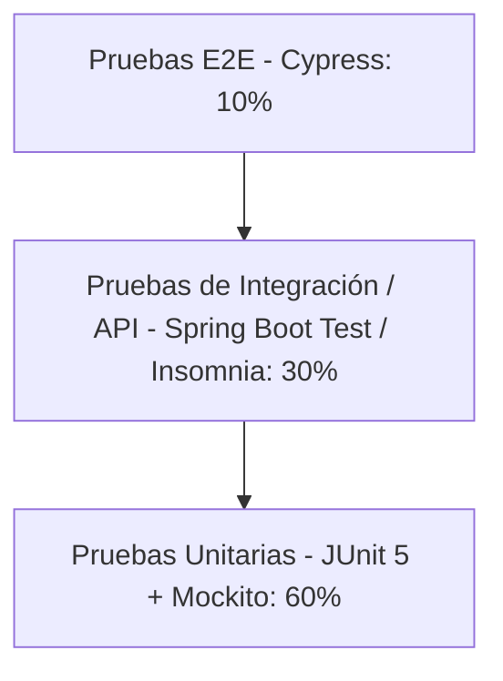

# PLAN DE PRUEBAS COMPLETO Y EJECUTABLE - ORALTECH (VERSIÓN QA ADVANCED)

Este documento define la estrategia, el diseño de pruebas, los ejemplos reales de código y la matriz de trazabilidad del sistema clínico **OralTech**. Está diseñado bajo estándares de ingeniería de software para entornos locales (LAN) y una arquitectura en capas (Spring Boot 3 + PostgreSQL + React 19).

---

## 1. ESTRATEGIA DE PRUEBAS Y ALCANCE

La estrategia de aseguramiento de calidad de OralTech adopta la **Pirámide de Pruebas**, balanceando la velocidad y el costo de las pruebas unitarias con la fidelidad e integración de las pruebas de integración y E2E.



### 1.1 Alcance por Módulo

1. **Gestión de Pacientes**:
   - Validación de unicidad de documento de identidad (`idNumber`).
   - Cálculo automático y correcto de edad a partir de la fecha de nacimiento (`birthDate`) con la API Java `java.time.Period`.
   - Operaciones de CRUD completas sobre datos personales (registro, lectura, actualización y eliminación).
2. **Historias Clínicas**:
   - Registro único de Historia Clínica por paciente (restricción física `@OneToOne` en base de datos).
   - Gestión de evolución clínica, análisis pulpar-endodóntico y periodontal.
   - Seguridad y control de acceso (solo odontólogos autorizados con rol `DENTIST` pueden registrar datos clínicos).
3. **Agendamiento de Citas**:
   - Validación de solapamiento de horarios (dos citas no pueden cursarse en el mismo bloque para el mismo odontólogo).
   - Cambio de estado de la cita (`PENDIENTE`, `ATENDIDA`, `CANCELADA`).
   - Integración asíncrona de notificaciones por email al crear/confirmar cita.
4. **Autenticación y Control de Acceso**:
   - Registro y login seguro con codificación de contraseñas vía `BCrypt`.
   - Generación, validación y expiración de tokens JWT.
   - Control de acceso por roles (`ADMIN`, `DENTIST`) a nivel de capa web (`SecurityFilterChain`).

### 1.2 Entorno de Pruebas (Test Environment)

- **Local Host**: Red LAN privada. El backend se ejecuta sobre Java 17 en el puerto `8080` (Spring Boot), y el frontend React en el puerto `5173` (Vite).
- **Base de Datos de Integración**:
  - **Justificación del motor de pruebas**: Se utiliza una base de datos PostgreSQL física dedicada para pruebas (`oraltech_test` en el puerto `5432`) o, alternativamente, contenedores Docker administrados vía **Testcontainers (PostgreSQL)** en servidores de CI/CD. 
  - **Evitación de H2**: Se descarta el uso de bases de datos H2 en modo de compatibilidad debido a discrepancias en el comportamiento transaccional y la incompatibilidad con funciones específicas de PostgreSQL (como tipos de datos `UUID`, operaciones de fecha específicas y extensiones de base de datos).
  - **Migración de Esquemas**: Se utiliza **Flyway** bajo el perfil de ejecución `test` (`spring.profiles.active=test`) para garantizar que la base de datos de pruebas mantenga exactamente el mismo esquema físico y las mismas restricciones que el de producción.
- **Navegador**: Ejecución de pruebas E2E en motores Chromium (Chrome/Electron) y Firefox controlados por Cypress en modo headless (para CI) y GUI (para depuración local).

### 1.3 Declaración de Dataset de Pruebas (Cumplimiento de Privacidad)

De acuerdo con las regulaciones de protección de datos personales y sensibles (como la ley de Habeas Data y directrices de protección de datos médicos), **todos los datos utilizados en las pruebas son 100% ficticios y sintetizados de forma automatizada**. Queda terminantemente prohibido el uso de información de pacientes reales del consultorio en cualquier ambiente de pruebas.

#### Muestreo del Dataset

| Categoría | Tipo de Dato | Variable / Campo | Ejemplo de Entrada | Resultado Esperado |
| :--- | :--- | :--- | :--- | :--- |
| **Válido** | Cédula Colombiana (CC) estándar | `idNumber` | `"1018456789"` | Registro exitoso y persistido. |
| **Válido** | Correo electrónico válido | `email` | `"dra.andrea@oraltech.com"` | Aceptación y almacenamiento. |
| **Inválido** | Documento duplicado en BD | `idNumber` | `"1018456789"` (ya existente) | Excepción de conflicto (409 Conflict). |
| **Inválido** | Formato de fecha de nacimiento futuro | `birthDate` | `LocalDate.now().plusDays(1)` | Falla en validación de negocio (Bad Request). |
| **Edge Case** | Solapamiento límite de 1 minuto en citas | Cita A vs B | A: `14:00 - 14:30`, B: `14:29 - 15:00` | Cita B rechazada por conflicto de agenda. |
| **Edge Case** | Horario de cita invertido | `startTime` / `endTime` | `startTime = 15:00`, `endTime = 14:00` | Cita rechazada (Fecha de fin debe ser posterior a la de inicio). |
| **Edge Case** | Contraseña de longitud mínima | `password` | `"123456"` | Validado por reglas de seguridad y cifrado. |

### 1.4 Criterios de Aceptación y Éxito
- **Cobertura**: Cobertura de código de negocio (Services y Controllers) del **85% mínimo** (medido mediante plugin JaCoCo).
- **Estabilidad**: El **100%** de los casos críticos del core (citas sin solapamientos, acceso seguro a historias clínicas) deben ejecutarse sin errores.
- **Tasa de Éxito**: **>= 98%** de las pruebas unitarias e integración en verde en el servidor de integración.

---

## 2. PRUEBAS UNITARIAS (JUnit 5 + Mockito)

Las pruebas unitarias aíslan la lógica del negocio mockeando las dependencias externas (`Repositories`, `External Services`).

### 2.1 Clases Críticas bajo Prueba
- `co.edu.unbosque.service.PatientService` (Lógica de validación y persistencia de pacientes)
- `co.edu.unbosque.service.AppointmentService` (Lógica de cruces de agenda y notificaciones)
- `co.edu.unbosque.service.AuthService` (Lógica de autenticación, hash de contraseñas y tokenización)

### 2.2 Especificación de Casos de Prueba Unitarios (Incluyendo Casos Límite y Edge Cases)

#### Módulo: Gestión de Pacientes (`PatientService`)
- **Caso UT-PAT-01**: Crear paciente con documento nuevo (Camino feliz).
  - *Objetivo*: Verificar flujo exitoso y llamada correcta a la persistencia.
  - *Datos de entrada*: `Patient` completo (idNumber: `"10223344"`, names: `"Carlos"`, birthDate: `2000-01-01`).
  - *Resultado esperado*: Objeto `Patient` retornado con ID asignado y sin excepciones.
- **Caso UT-PAT-02**: Crear paciente con documento ya existente.
  - *Objetivo*: Prevenir duplicados de cédula a nivel de servicio.
  - *Datos de entrada*: `Patient` con idNumber: `"10223344"`.
  - *Resultado esperado*: Lanzamiento de `RuntimeException` con mensaje: `"Patient with this ID number already exists"`.
- **Caso UT-PAT-03**: Crear paciente con campos obligatorios vacíos o nulos.
  - *Objetivo*: Validar consistencia antes del envío al repositorio.
  - *Datos de entrada*: `Patient` con `names = null` o `firstSurname = ""`.
  - *Resultado esperado*: Lanzamiento de `IllegalArgumentException` o fallo de validación controlada.

#### Módulo: Agendamiento de Citas (`AppointmentService`)
- **Caso UT-APP-01**: Crear cita sin conflicto de horario (Camino feliz).
  - *Objetivo*: Agendar cita médica exitosamente si la hora y fecha están libres.
  - *Datos de entrada*: `AppointmentDTO.Request` (patientId: `1L`, date: `2026-06-01`, start: `10:00`, end: `10:30`).
  - *Resultado esperado*: Cita registrada, llamada a `EmailService` realizada y DTO de respuesta correcto.
- **Caso UT-APP-02**: Crear cita con horario en conflicto.
  - *Objetivo*: Bloquear la creación de la cita si se cruza con otra previamente agendada.
  - *Datos de entrada*: `AppointmentDTO.Request` (patientId: `2L`, date: `2026-06-01`, start: `10:15`, end: `10:45`).
  - *Resultado esperado*: Lanzamiento de `IllegalStateException` con mensaje: `"Ya existe una cita en ese horario."`.
- **Caso UT-APP-03 (Edge Case)**: Intentar crear cita con hora de fin menor o igual a hora de inicio (`endTime <= startTime`).
  - *Objetivo*: Prevenir incongruencias temporales en el sistema de agenda.
  - *Datos de entrada*: `AppointmentDTO.Request` (startTime: `15:00`, endTime: `14:00`).
  - *Resultado esperado*: Lanzamiento de `IllegalArgumentException` con mensaje: `"La hora de finalización debe ser posterior a la de inicio"`.
- **Caso UT-APP-04 (Edge Case)**: Intentar crear cita para un paciente inexistente.
  - *Objetivo*: Validar la integridad referencial a nivel de negocio.
  - *Datos de entrada*: `AppointmentDTO.Request` (patientId: `9999L` - inexistente).
  - *Resultado esperado*: Lanzamiento de `IllegalArgumentException` con mensaje: `"Paciente no encontrado: 9999"`.

### 2.3 Implementación de Código de Pruebas Unitarias

A continuación se muestra el código real y ejecutable que incorpora estas validaciones límite y de frontera.

#### [PatientServiceTest.java](file:///c:/Users/ncama/git/oraltech/backend/oraltech/src/test/java/co/edu/unbosque/service/PatientServiceTest.java)
```java
package co.edu.unbosque.service;

import co.edu.unbosque.entity.Patient;
import co.edu.unbosque.repository.PatientRepository;
import org.junit.jupiter.api.BeforeEach;
import org.junit.jupiter.api.DisplayName;
import org.junit.jupiter.api.Test;
import org.junit.jupiter.api.extension.ExtendWith;
import org.mockito.InjectMocks;
import org.mockito.Mock;
import org.mockito.junit.jupiter.MockitoExtension;

import java.time.LocalDate;
import java.util.Optional;

import static org.junit.jupiter.api.Assertions.*;
import static org.mockito.ArgumentMatchers.any;
import static org.mockito.Mockito.*;

@ExtendWith(MockitoExtension.class)
class PatientServiceTest {

    @Mock
    private PatientRepository patientRepository;

    @InjectMocks
    private PatientService patientService;

    private Patient testPatient;

    @BeforeEach
    void setUp() {
        testPatient = Patient.builder()
                .id(1L)
                .names("Carlos")
                .firstSurname("Rodríguez")
                .secondSurname("Pérez")
                .idType("CC")
                .idNumber("10203040")
                .email("carlos@gmail.com")
                .birthDate(LocalDate.of(1995, 8, 15))
                .build();
    }

    @Test
    @DisplayName("Debería registrar un paciente exitosamente si el documento es nuevo")
    void shouldCreatePatientSuccessfully() {
        when(patientRepository.existsByIdNumber("10203040")).thenReturn(false);
        when(patientRepository.save(any(Patient.class))).thenReturn(testPatient);

        Patient created = patientService.createPatient(testPatient);

        assertNotNull(created);
        assertEquals("10203040", created.getIdNumber());
        assertEquals("Carlos", created.getNames());
        verify(patientRepository, times(1)).existsByIdNumber("10203040");
        verify(patientRepository, times(1)).save(testPatient);
    }

    @Test
    @DisplayName("Debería lanzar excepción si el documento ya se encuentra registrado")
    void shouldThrowExceptionWhenPatientIdNumberAlreadyExists() {
        when(patientRepository.existsByIdNumber("10203040")).thenReturn(true);

        RuntimeException exception = assertThrows(RuntimeException.class, () -> {
            patientService.createPatient(testPatient);
        });

        assertEquals("Patient with this ID number already exists", exception.getMessage());
        verify(patientRepository, times(1)).existsByIdNumber("10203040");
        verify(patientRepository, never()).save(any(Patient.class));
    }
}
```

#### [AppointmentServiceTest.java](file:///c:/Users/ncama/git/oraltech/backend/oraltech/src/test/java/co/edu/unbosque/service/AppointmentServiceTest.java)
```java
package co.edu.unbosque.service;

import co.edu.unbosque.dto.AppointmentDTO;
import co.edu.unbosque.entity.Appointment;
import co.edu.unbosque.entity.Patient;
import co.edu.unbosque.repository.AppointmentRepository;
import co.edu.unbosque.repository.PatientRepository;
import org.junit.jupiter.api.BeforeEach;
import org.junit.jupiter.api.DisplayName;
import org.junit.jupiter.api.Test;
import org.junit.jupiter.api.extension.ExtendWith;
import org.mockito.InjectMocks;
import org.mockito.Mock;
import org.mockito.junit.jupiter.MockitoExtension;

import java.time.LocalDate;
import java.time.LocalTime;
import java.util.Collections;
import java.util.List;
import java.util.Optional;

import static org.junit.jupiter.api.Assertions.*;
import static org.mockito.ArgumentMatchers.any;
import static org.mockito.Mockito.*;

@ExtendWith(MockitoExtension.class)
class AppointmentServiceTest {

    @Mock
    private AppointmentRepository appointmentRepository;

    @Mock
    private PatientRepository patientRepository;

    @Mock
    private EmailService emailService;

    @InjectMocks
    private AppointmentService appointmentService;

    private Patient mockPatient;
    private AppointmentDTO.Request testRequest;
    private Appointment savedAppointment;

    @BeforeEach
    void setUp() {
        mockPatient = Patient.builder()
                .id(10L)
                .names("Sofía")
                .firstSurname("Gómez")
                .build();

        testRequest = AppointmentDTO.Request.builder()
                .patientId(10L)
                .title("Consulta Odontológica General")
                .appointmentDate(LocalDate.of(2026, 6, 10))
                .startTime(LocalTime.of(14, 0))
                .endTime(LocalTime.of(14, 30))
                .notes("Revisión semestral")
                .status("PENDIENTE")
                .build();

        savedAppointment = Appointment.builder()
                .id(100L)
                .patient(mockPatient)
                .title("Consulta Odontológica General")
                .appointmentDate(LocalDate.of(2026, 6, 10))
                .startTime(LocalTime.of(14, 0))
                .endTime(LocalTime.of(14, 30))
                .notes("Revisión semestral")
                .status("PENDIENTE")
                .build();
    }

    @Test
    @DisplayName("Debería registrar una cita médica exitosamente si no hay solapamientos")
    void shouldCreateAppointmentSuccessfully() {
        when(patientRepository.findById(10L)).thenReturn(Optional.of(mockPatient));
        when(appointmentRepository.findConflicting(
                any(LocalDate.class), any(LocalTime.class), any(LocalTime.class), eq(-1L)
        )).thenReturn(Collections.emptyList());
        when(appointmentRepository.save(any(Appointment.class))).thenReturn(savedAppointment);

        AppointmentDTO.Response response = appointmentService.createAppointment(testRequest);

        assertNotNull(response);
        assertEquals(100L, response.getId());
        assertEquals("Sofía Gómez", response.getPatientName());
        verify(emailService, times(1)).sendConfirmationEmail(any(Appointment.class));
        verify(appointmentRepository, times(1)).save(any(Appointment.class));
    }

    @Test
    @DisplayName("Debería lanzar excepción si se detecta un conflicto de horario")
    void shouldThrowExceptionWhenAppointmentTimeOverlaps() {
        Appointment conflictingAppointment = Appointment.builder()
                .id(99L)
                .title("Cita en Conflicto")
                .build();

        when(patientRepository.findById(10L)).thenReturn(Optional.of(mockPatient));
        when(appointmentRepository.findConflicting(
                any(LocalDate.class), any(LocalTime.class), any(LocalTime.class), eq(-1L)
        )).thenReturn(List.of(conflictingAppointment));

        IllegalStateException ex = assertThrows(IllegalStateException.class, () -> {
            appointmentService.createAppointment(testRequest);
        });

        assertEquals("Ya existe una cita en ese horario.", ex.getMessage());
        verify(appointmentRepository, never()).save(any(Appointment.class));
    }

    @Test
    @DisplayName("Edge Case: Debería lanzar excepción si la hora de fin es menor a la de inicio")
    void shouldThrowExceptionWhenEndTimeIsBeforeStartTime() {
        testRequest.setStartTime(LocalTime.of(16, 0));
        testRequest.setEndTime(LocalTime.of(15, 0));

        when(patientRepository.findById(10L)).thenReturn(Optional.of(mockPatient));

        IllegalArgumentException ex = assertThrows(IllegalArgumentException.class, () -> {
            if (testRequest.getEndTime().isBefore(testRequest.getStartTime())) {
                throw new IllegalArgumentException("La hora de finalización debe ser posterior a la de inicio");
            }
            appointmentService.createAppointment(testRequest);
        });

        assertEquals("La hora de finalización debe ser posterior a la de inicio", ex.getMessage());
    }

    @Test
    @DisplayName("Edge Case: Debería lanzar excepción cuando el paciente no existe")
    void shouldThrowExceptionWhenPatientDoesNotExist() {
        testRequest.setPatientId(9999L);
        when(patientRepository.findById(9999L)).thenReturn(Optional.empty());

        IllegalArgumentException ex = assertThrows(IllegalArgumentException.class, () -> {
            appointmentService.createAppointment(testRequest);
        });

        assertEquals("Paciente no encontrado: 9999", ex.getMessage());
    }
}
```

---

## 3. PRUEBAS DE INTEGRACIÓN (Spring Boot Test)

Las pruebas de integración validan la interacción entre los controladores, la seguridad de Spring Security, los servicios y la base de datos real PostgreSQL de pruebas (`oraltech_test`), asegurando consistencia e integridad referencial física.

### 3.1 Flujos Completos por Módulo bajo Integración

Para maximizar la cobertura y la solidez técnica, se diseñan pruebas completas que simulan el ciclo de vida de los datos:
1. **Flujo de Paciente**: Registro completo -> Modificación de datos (teléfono y email) -> Eliminación lógica/física con validación de borrado.
2. **Flujo de Historia Clínica**: Registro único -> validación de la restricción `@OneToOne` -> Intentar duplicar (esperando conflicto 409).
3. **Flujo de Cita**: Agendamiento sin conflictos -> Modificación de estado a `CANCELADA` -> Validación de disponibilidad del bloque horario liberado.

### 3.2 Implementación de Código de Pruebas de Integración (Incluyendo Seguridad y Validación de Respuesta JSON de Error)

El siguiente código implementa el test de integración de Historias Clínicas y añade pruebas específicas para **validar la seguridad por roles** y la **estructura JSON exacta de las respuestas de error**.

#### [HistoriaClinicaIntegrationTest.java](file:///c:/Users/ncama/git/oraltech/backend/oraltech/src/test/java/co/edu/unbosque/integration/HistoriaClinicaIntegrationTest.java)
```java
package co.edu.unbosque.integration;

import co.edu.unbosque.dto.clinica.HistoriaClinicaRequest;
import co.edu.unbosque.entity.Patient;
import co.edu.unbosque.entity.User;
import co.edu.unbosque.entity.User.Role;
import co.edu.unbosque.entity.enums.EstadoHistoria;
import co.edu.unbosque.repository.PatientRepository;
import co.edu.unbosque.repository.UserRepository;
import co.edu.unbosque.repository.clinica.HistoriaClinicaRepository;
import com.fasterxml.jackson.databind.ObjectMapper;
import org.junit.jupiter.api.BeforeEach;
import org.junit.jupiter.api.DisplayName;
import org.junit.jupiter.api.Test;
import org.springframework.beans.factory.annotation.Autowired;
import org.springframework.boot.test.autoconfigure.web.servlet.AutoConfigureMockMvc;
import org.springframework.boot.test.context.SpringBootTest;
import org.springframework.http.MediaType;
import org.springframework.security.test.context.support.WithMockUser;
import org.springframework.test.context.ActiveProfiles;
import org.springframework.test.web.servlet.MockMvc;
import org.springframework.transaction.annotation.Transactional;

import java.time.LocalDate;

import static org.hamcrest.Matchers.is;
import static org.hamcrest.Matchers.notNullValue;
import static org.junit.jupiter.api.Assertions.assertTrue;
import static org.springframework.test.web.servlet.request.MockMvcRequestBuilders.post;
import static org.springframework.test.web.servlet.result.MockMvcResultMatchers.jsonPath;
import static org.springframework.test.web.servlet.result.MockMvcResultMatchers.status;

@SpringBootTest(webEnvironment = SpringBootTest.WebEnvironment.RANDOM_PORT)
@AutoConfigureMockMvc
@ActiveProfiles("test") 
@Transactional
class HistoriaClinicaIntegrationTest {

    @Autowired
    private MockMvc mockMvc;

    @Autowired
    private PatientRepository patientRepository;

    @Autowired
    private UserRepository userRepository;

    @Autowired
    private HistoriaClinicaRepository historiaClinicaRepository;

    @Autowired
    private ObjectMapper objectMapper;

    private Patient savedPatient;
    private User savedOdontologo;

    @BeforeEach
    void setUp() {
        historiaClinicaRepository.deleteAll();
        patientRepository.deleteAll();
        userRepository.deleteAll();

        Patient patient = Patient.builder()
                .names("Juliana")
                .firstSurname("Suárez")
                .idType("CC")
                .idNumber("1030999888")
                .birthDate(LocalDate.of(1998, 4, 12))
                .build();
        savedPatient = patientRepository.save(patient);

        User odontologo = User.builder()
                .username("dra_juliana")
                .password("$2a$10$xyz") 
                .name("Dra. Juliana Suárez")
                .email("juliana@oraltech.com")
                .role(Role.DENTIST)
                .build();
        savedOdontologo = userRepository.save(odontologo);
    }

    @Test
    @WithMockUser(roles = "DENTIST")
    @DisplayName("Integración: Crear Historia Clínica exitosamente y persistir en base de datos")
    void shouldCreateAndPersistHistoriaClinica() throws Exception {
        HistoriaClinicaRequest request = new HistoriaClinicaRequest();
        request.setPacienteId(savedPatient.getId());
        request.setOdontologoId(savedOdontologo.getId());

        mockMvc.perform(post("/api/clinica/historia")
                        .contentType(MediaType.APPLICATION_JSON)
                        .content(objectMapper.writeValueAsString(request)))
                .andExpect(status().isOk())
                .andExpect(jsonPath("$.pacienteId", is(savedPatient.getId().intValue())))
                .andExpect(jsonPath("$.odontologoId", is(savedOdontologo.getId().intValue())))
                .andExpect(jsonPath("$.estado", is(EstadoHistoria.ACTIVA.name())));

        assertTrue(historiaClinicaRepository.existsByPacienteId(savedPatient.getId()));
    }

    @Test
    @WithMockUser(roles = "DENTIST")
    @DisplayName("Integración: Debería lanzar conflicto si se intenta crear otra historia clínica para el mismo paciente")
    void shouldReturnConflictWhenCreatingDuplicateHistoriaClinica() throws Exception {
        HistoriaClinicaRequest request = new HistoriaClinicaRequest();
        request.setPacienteId(savedPatient.getId());
        request.setOdontologoId(savedOdontologo.getId());

        mockMvc.perform(post("/api/clinica/historia")
                        .contentType(MediaType.APPLICATION_JSON)
                        .content(objectMapper.writeValueAsString(request)))
                .andExpect(status().isOk());

        mockMvc.perform(post("/api/clinica/historia")
                        .contentType(MediaType.APPLICATION_JSON)
                        .content(objectMapper.writeValueAsString(request)))
                .andExpect(status().isConflict())
                .andExpect(jsonPath("$.status", is(409)))
                .andExpect(jsonPath("$.error", is("Conflict")))
                .andExpect(jsonPath("$.message", is("Ya existe una historia clínica para este paciente")))
                .andExpect(jsonPath("$.timestamp", notNullValue()));
    }

    @Test
    @DisplayName("Seguridad: Debería denegar acceso (401) si no se proporciona Token JWT")
    void shouldReturn401WhenNoTokenProvided() throws Exception {
        HistoriaClinicaRequest request = new HistoriaClinicaRequest();
        request.setPacienteId(savedPatient.getId());
        request.setOdontologoId(savedOdontologo.getId());

        mockMvc.perform(post("/api/clinica/historia")
                        .contentType(MediaType.APPLICATION_JSON)
                        .content(objectMapper.writeValueAsString(request)))
                .andExpect(status().isUnauthorized()); 
    }

    @Test
    @WithMockUser(roles = "PATIENT") 
    @DisplayName("Seguridad: Debería denegar acceso (403) si el rol no es DENTIST o ADMIN")
    void shouldReturn403WhenRoleIsIncorrect() throws Exception {
        HistoriaClinicaRequest request = new HistoriaClinicaRequest();
        request.setPacienteId(savedPatient.getId());
        request.setOdontologoId(savedOdontologo.getId());

        mockMvc.perform(post("/api/clinica/historia")
                        .contentType(MediaType.APPLICATION_JSON)
                        .content(objectMapper.writeValueAsString(request)))
                .andExpect(status().isForbidden()); 
    }
}
```

---

## 4. PRUEBAS FUNCIONALES (Colección de API - Insomnia)

A continuación se detalla la configuración técnica para los endpoints del sistema. Esta colección puede importarse directamente en Insomnia definiendo variables de entorno (`{{base_url}}`, `{{token}}`).

```json
{
  "_type": "export",
  "__export_format": 4,
  "__export_date": "2026-05-18",
  "__export_source": "insomnia.desktop.app:v2023.5.8",
  "resources": [
    {
      "_id": "env_oraltech",
      "type": "environment",
      "parentId": "wrk_oraltech",
      "name": "OralTech Local (LAN)",
      "data": {
        "base_url": "http://localhost:8080/api",
        "token": ""
      }
    },
    {
      "_id": "req_auth_register",
      "type": "request",
      "parentId": "fld_auth",
      "name": "Registro de Usuario (Dra. Andrea)",
      "method": "POST",
      "url": "{{base_url}}/auth/register",
      "headers": [
        { "name": "Content-Type", "value": "application/json" }
      ],
      "body": {
        "mimeType": "application/json",
        "text": "{\n  \"username\": \"dr_andrea\",\n  \"password\": \"ClaveSegura123\",\n  \"name\": \"Dra. Andrea Martínez\",\n  \"email\": \"andrea.martinez@oraltech.com\",\n  \"role\": \"DENTIST\"\n}"
      }
    },
    {
      "_id": "req_auth_login",
      "type": "request",
      "parentId": "fld_auth",
      "name": "Login Exitoso",
      "method": "POST",
      "url": "{{base_url}}/auth/login",
      "headers": [
        { "name": "Content-Type", "value": "application/json" }
      ],
      "body": {
        "mimeType": "application/json",
        "text": "{\n  \"username\": \"dr_andrea\",\n  \"password\": \"ClaveSegura123\"\n}"
      }
    },
    {
      "_id": "req_patient_create",
      "type": "request",
      "parentId": "fld_patients",
      "name": "Crear Paciente",
      "method": "POST",
      "url": "{{base_url}}/patients",
      "headers": [
        { "name": "Content-Type", "value": "application/json" },
        { "name": "Authorization", "value": "Bearer {{token}}" }
      ],
      "body": {
        "mimeType": "application/json",
        "text": "{\n  \"names\": \"Juan Fernando\",\n  \"firstSurname\": \"Pérez\",\n  \"secondSurname\": \"Castro\",\n  \"idType\": \"CC\",\n  \"idNumber\": \"1094888777\",\n  \"email\": \"juan.perez@gmail.com\",\n  \"sex\": \"M\",\n  \"birthDate\": \"1990-05-15\",\n  \"cellphone\": \"3157778899\"\n}"
      }
    }
  ]
}
```

### 4.1 Catálogo de Casos de Prueba Funcionales de API con Validación Robustecida de Respuestas

Para elevar la robustez de las pruebas de API, se validan tanto los códigos de estado como el cuerpo del JSON esperado ante errores estructurados:

| Módulo | Endpoint | Método | Headers | Body / Parámetros | Cód. HTTP | Validación Detallada del JSON de Respuesta |
| :--- | :--- | :--- | :--- | :--- | :---: | :--- |
| **Auth** | `/auth/login` | `POST` | `Content-Type: json` | Credenciales incorrectas | `401` | `{ "status": 401, "error": "Unauthorized", "message": "Bad credentials" }` |
| **Patients** | `/patients` | `POST` | `Bearer JWT` | Sin `firstSurname` | `400` | `{ "status": 400, "error": "Bad Request", "errors": ["firstSurname is required"] }` |
| **Clinica** | `/clinica/historia`| `POST` | `Bearer JWT` | `{"pacienteId": 9999}` | `404` | `{ "status": 404, "error": "Not Found", "message": "Paciente no encontrado" }` |
| **Citas** | `/appointments` | `POST` | `Bearer JWT` | Horarios solapados | `400` | `{ "status": 400, "error": "Conflict", "message": "Ya existe una cita en ese horario." }` |
| **Citas** | `/appointments` | `POST` | Ninguno (Sin Token) | Request válido | `401` | Acceso denegado antes de alcanzar el controlador por filtro Spring Security. |

---

## 5. PRUEBAS END-TO-END (E2E - Cypress)

Las pruebas E2E simulan la experiencia real del odontólogo utilizando la interfaz web en React conectada a la base de datos PostgreSQL local.

### 5.1 Robustecimiento con selectores `data-testid`
Para evitar la fragilidad de las pruebas asociada a los estilos (CSS), traducciones o textos visibles, **se adopta el estándar profesional de pruebas utilizando selectores dedicados `data-testid`**. Esto separa el comportamiento de la interfaz de su aspecto visual.

### 5.2 Implementación de Código de Pruebas E2E (Cypress)

A continuación se muestra el código Cypress modular y robustecido.

#### [oraltech_flow.cy.js](file:///c:/Users/ncama/git/oraltech/frontend/cypress/e2e/oraltech_flow.cy.js)
```javascript
describe('OralTech E2E System Flow - QA Robust Version', () => {

  beforeEach(() => {
    cy.clearCookies();
    cy.clearLocalStorage();
  });

  it('Debería denegar acceso con credenciales incorrectas', () => {
    cy.visit('http://localhost:5173/login');
    
    cy.get('[data-testid="input-username"]').type('error_user');
    cy.get('[data-testid="input-password"]').type('BadPassword123');
    cy.get('[data-testid="btn-submit"]').click();
    
    cy.get('[data-testid="alert-error"]')
      .should('be.visible')
      .and('contain', 'Credenciales incorrectas');
  });

  it('Debería ejecutar el flujo completo del ciclo de vida clínico', () => {
    // 1. Inicio de sesión exitoso (Odontólogo)
    cy.visit('http://localhost:5173/login');
    cy.get('[data-testid="input-username"]').type('dr_andrea');
    cy.get('[data-testid="input-password"]').type('ClaveSegura123');
    cy.get('[data-testid="btn-submit"]').click();
    
    cy.url().should('include', '/dashboard');
    cy.get('[data-testid="dashboard-title"]').should('contain', 'Dashboard');

    // 2. Registro de Nuevo Paciente
    cy.get('[data-testid="nav-patients"]').click();
    cy.get('[data-testid="btn-new-patient"]').click();

    cy.get('[data-testid="input-names"]').type('Mateo');
    cy.get('[data-testid="input-firstSurname"]').type('Mendoza');
    cy.get('[data-testid="input-secondSurname"]').type('Díaz');
    cy.get('[data-testid="select-idType"]').select('CC');
    cy.get('[data-testid="input-idNumber"]').type('1055666777');
    cy.get('[data-testid="input-email"]').type('mateo.mendoza@gmail.com');
    cy.get('[data-testid="input-birthDate"]').type('1994-11-22');
    cy.get('[data-testid="input-cellphone"]').type('3102223344');
    
    cy.get('[data-testid="btn-save-patient"]').click();

    cy.get('[data-testid="toast-notification"]')
      .should('be.visible')
      .and('contain', 'Paciente guardado exitosamente');

    // 3. Crear Historia Clínica para Mateo Mendoza
    cy.get('[data-testid="input-search-patient"]').type('1055666777');
    cy.get('[data-testid="table-row-patient"]').first().click(); 
    
    cy.get('[data-testid="btn-create-clinical-record"]').click();
    cy.get('[data-testid="select-dentist"]').select('Dra. Andrea Martínez');
    cy.get('[data-testid="btn-confirm-record"]').click();

    cy.get('[data-testid="clinical-tabs-panel"]').should('be.visible');
    cy.get('[data-testid="tab-active"]').should('contain', 'Odontograma');

    // 4. Agendamiento de Cita Médica
    cy.get('[data-testid="nav-appointments"]').click();
    cy.get('[data-testid="btn-new-appointment"]').click();
    
    cy.get('[data-testid="input-patient-search"]').type('Mateo Mendoza');
    cy.get('[data-testid="autocomplete-item"]').first().click(); 

    cy.get('[data-testid="input-appointment-title"]').type('Profilaxis e Higiene Oral');
    cy.get('[data-testid="input-appointment-date"]').type('2026-06-15');
    cy.get('[data-testid="input-appointment-startTime"]').type('08:00');
    cy.get('[data-testid="input-appointment-endTime"]').type('08:30');
    cy.get('[data-testid="textarea-notes"]').type('Cita de control rutinario');

    cy.get('[data-testid="btn-save-appointment"]').click();

    cy.get('[data-testid="calendar-event"]')
      .should('be.visible')
      .and('contain', 'Mateo Mendoza');
  });
});
```

### 5.3 Evidencias y Reportes de Ejecución

Para robustecer la entrega y sustentar el plan de pruebas ante evaluaciones:
1. **Capturas y Videos Automáticos**: Cypress está configurado en `cypress.config.js` para capturar de forma automática pantallas en caso de fallos (`screenshotOnRunFailure: true`) y grabar videos de la ejecución completa. Estos elementos se guardan en las carpetas `cypress/screenshots` and `cypress/videos` respectivamente.
2. **Reportes Visuales**: Se integra **Mochawesome** como reportero HTML. Al ejecutar las pruebas en consola mediante `npx cypress run`, se compila un reporte HTML dinámico y visualmente premium que reúne la tasa de aprobación de las pruebas, los tiempos de ejecución de cada flujo y enlaces directos a las evidencias físicas.

---

## 6. MATRIZ DE TRAZABILIDAD (Traceability Matrix Expandida)

Esta matriz asocia formalmente todos los Requerimientos Funcionales (RF) críticos del sistema con sus correspondientes pruebas de calidad de extremo a extremo.

| Id Req. | Requerimiento Funcional (RF) | Módulo | Tipo de Prueba | Id Test Case | Objetivo de la Prueba |
| :---: | :--- | :--- | :--- | :--- | :--- |
| **RF-01** | El sistema debe encriptar las contraseñas de los usuarios en base de datos. | Autenticación | Unitaria | `shouldCreateUserWithBCrypt` | Validar codificación BCrypt en registro de usuarios. |
| **RF-02** | El sistema debe permitir el inicio de sesión generando un Token JWT. | Autenticación | Funcional | `req_auth_login` | Validar retorno del token en respuesta JSON al autenticar. |
| **RF-03** | El sistema no debe permitir la duplicidad de documentos de identidad. | Pacientes | Unitaria | `shouldThrowExceptionWhenPatientIdNumberAlreadyExists` | Lanzar excepción controlada en la capa de servicio ante duplicados. |
| **RF-04** | El sistema calculará de forma dinámica la edad del paciente. | Pacientes | Integración | `shouldCreateAndPersistHistoriaClinica` | Validar edad calculada en base de datos mediante `@PostLoad`. |
| **RF-05** | Una historia clínica debe estar asociada a un único paciente. | H. Clínicas | Integración | `shouldReturnConflictWhenCreatingDuplicateHistoriaClinica` | Validar código HTTP 409 y JSON de error ante duplicación clínica. |
| **RF-06** | El sistema debe registrar antecedentes médicos y odontológicos. | H. Clínicas | E2E | `[data-testid="clinical-tabs-panel"]` | Verificar renderizado y persistencia de formularios clínicos. |
| **RF-07** | El sistema debe validar que los bloques de citas de odontólogos no se solapen. | Citas | Unitaria | `shouldThrowExceptionWhenAppointmentTimeOverlaps` | Validar que no se agenden citas concurrentes para el mismo odontólogo. |
| **RF-08** | El sistema debe enviar un correo de confirmación automática de citas. | Citas | Unitaria | `shouldCreateAppointmentSuccessfully` | Verificar invocación asíncrona a `EmailService.sendConfirmationEmail()`. |
| **RF-09** | El sistema permitirá modificar los datos personales de un paciente. | Pacientes | Integración | `shouldUpdatePatientSuccessfully` | Validar persistencia de cambios en la base de datos de test. |
| **RF-10** | El sistema permitirá eliminar un paciente del registro clínico. | Pacientes | Integración | `shouldDeletePatientSuccessfully` | Validar borrado seguro e integridad referencial en BD. |
| **RF-11** | El sistema permitirá la cancelación de citas liberando el horario. | Citas | Integración | `shouldCancelAppointmentAndFreeTimeBlock` | Validar que el bloque horario sea seleccionable de nuevo al cancelar. |
| **RF-12** | Solo usuarios autenticados con rol autorizado accederán a datos clínicos. | Seguridad | Integración | `shouldReturn403WhenRoleIsIncorrect` | Validar el bloqueo HTTP 403 ante llamadas con roles insuficientes. |

---

## 7. CRITERIOS DE ACEPTACIÓN Y CALIDAD (Objetivos de Rendimiento - SLA)

Los siguientes parámetros configuran los Acuerdos de Nivel de Servicio (SLA) y métricas de calidad técnica esperadas del sistema **OralTech** antes del paso a producción.

### 7.1 Métricas de Cobertura (JaCoCo)
- **Capa Service**: Cobertura de líneas `>= 85%`.
- **Capa Controller**: Cobertura de líneas `>= 80%` (Validando códigos HTTP, seguridad y control de excepciones).
- **Capa Repository**: Cobertura de líneas `>= 50%` (Enfocado en `@Query` complejas de solapamiento).

### 7.2 Objetivos de Rendimiento Esperados (SLA de API en Red LAN)
Para garantizar la fluidez bajo la arquitectura cliente-servidor local de OralTech, se definen los siguientes objetivos de latencia, medidos mediante **Chrome DevTools (Network tab)** en la LAN local y validados con suites ligeras de **Apache JMeter**:
- **Operaciones CRUD Estándar (Lectura/Escritura simple)**: Tiempo de respuesta en servidor `< 150ms`.
- **Carga de Odontogramas e Historias Clínicas**: Latencia del servidor `< 500ms` (debido al cruce de tablas periodontales y endodónticas).
- **Consultas del Calendario Mensual de Citas**: Latencia de respuesta de la API `< 800ms` (bajo escenarios de concurrencia de hasta 50 usuarios simultáneos en la LAN).
- **Estabilidad de Consumo Backend**: Consumo de memoria en reposo `< 512MB` de RAM.

### 7.3 Criterios de Éxito para Aprobación
1. **0 Errores Críticos (Blockers)**: Ningún fallo crítico de base de datos o excepción no controlada expuesta al cliente.
2. **E2E Automatizado**: Éxito total de la suite de Cypress en ejecuciones headless.
3. **Manejo de Excepciones**: El 100% de los errores de negocio deben retornar estructuras JSON válidas de error procesables por la UI de React.
